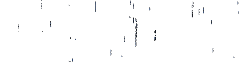
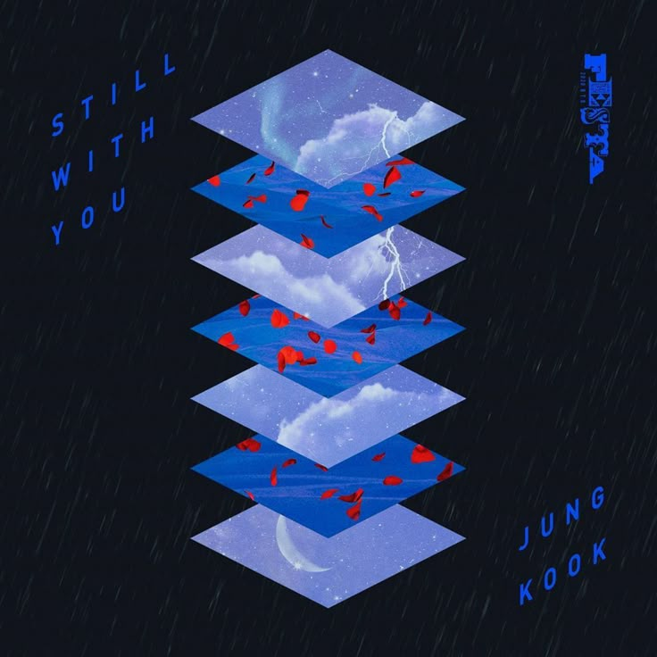

  

 <a href="https://silly3.atabook.org">

<table width="100%">
<tr>
<td width="75%" height="300" valign="top">

<table width="%">
<tr>
<td width="175" valign="top" align="left">

</td>
<td valign="middle" align="left">

</td>

<tr>
<td valign="bottom" align="left">

</td>
<td valign="middle" align="left">

</td>
</tr>
</table>

</td>

<td width="75%" align="center" valign="middle">

</td>
</tr>
</table>

　　　　　　*　　　　　　　　　　　　　　　　　　.
　　　　.　　　　.　　　⠀
　　　　　　　　　　　.
　　　　　　　
　　　˚　　　　　　　　ﾟ　　　　　.
　.⠀　　⠀‍　　　　　　　　.
　　　　.　　　　.　　　⠀
　　　　　　　　　　　.
　　　　　　　
　　　˚　　　　　　　　ﾟ　　　　　.
　.⠀　　⠀‍⠀‍⠀‍⠀‍⠀‍⠀‍⠀‍⠀‍⠀‍⠀‍⠀,
　　　*　　⠀.
　　　　　.　　　　　　　　　　⠀✦
　˚　　　　　　　　　　　　　　*
.⠀ 　　　　　　　　　　.　　　　　　　　.
　　　　　✦⠀　   　　　,　　    　　　　　　　　.
⠀⠀⠀⠀⠀⠀.　　　　　　　　　　⠀⠀⠀✦ ⠀ ⠀　　　　　　

 

<a href="https://silly3.atabook.org/">

  

   

  
  

  

  

  
   
  

</div

　　　　　　
 　　　˚　　　　　　　　　　.　　　　　　　
　　　　　 　*　　　　　　　　　　　˚
　.　　　　　　　　　　　　　　　　　　　
　　　　　　　　　　　　.　　　　　　　
　　　　　　　.　　　　　　　　　　　　
  　　　　　　　　˚　　　　　　　.　　　　　
　　.　　　　　　　　　　　　 　　*　　　　
　.  　　　　　　　　　.　　　　　　　　　　
　.   ˚　　　　　✧　　　　　　　　　　　.　　　
　. 　　　　.　　　　　　　　𖥔　　　. 　　　　
　　　　　　　　. 　　˚　　　　　　　　　　
　　　　　　　　　　　　.　　　　　　✦
　　　　　　.　　　　　　　　　　˚　　　　
   　✧　　　　　　　　　　　　　.　　　　　　
　　　　　　　　　.　　　　.  　　　　　
. .

